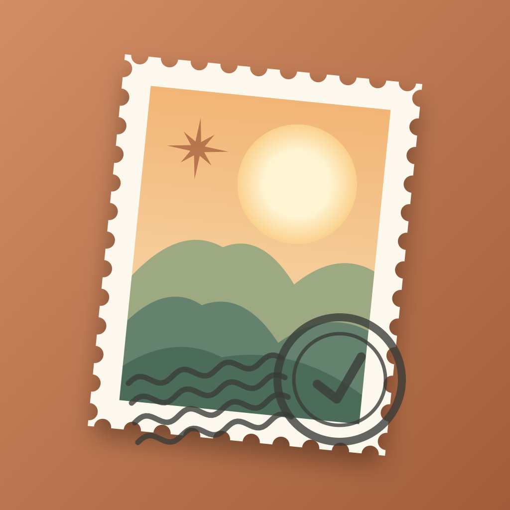
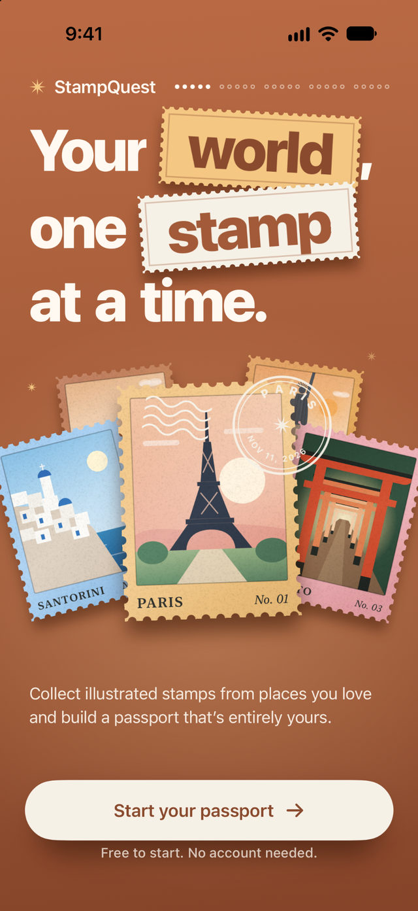
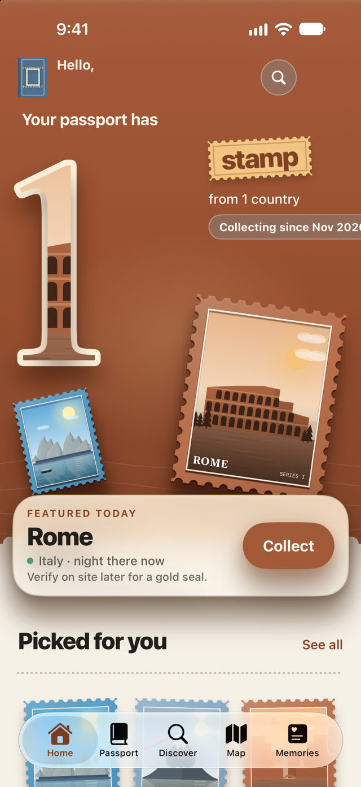
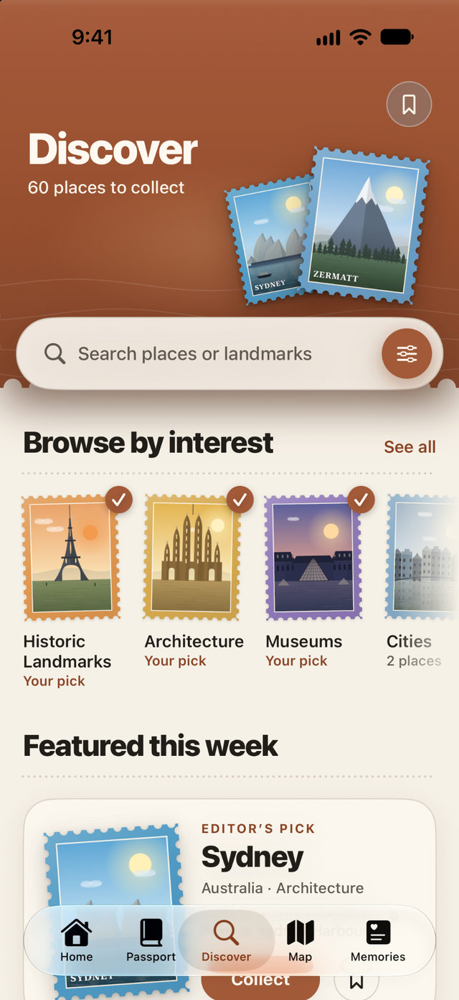

<div align="center">



# StampQuest

### Your world, one stamp at a time.

**Collect illustrated stamps. Build your passport. Remember everywhere you've been.**

A beautifully crafted, privacy-first travel companion for iPhone, built entirely with SwiftUI. Explore destinations, collect digital postage stamps, and turn your adventures into a passport that feels uniquely yours.

<p>
  
  
  
  
  <a href="LICENSE"></a>
</p>

[**Screenshots**](#screenshots) · [**Features**](#features) · [**How it works**](#how-it-works) · [**Build and run**](#build-and-run) · [**Architecture**](#architecture) · [**License**](#license)

</div>

---

## Screenshots

<div align="center">
<table>
  <tr>
    <td width="33%" align="center"></td>
    <td width="33%" align="center"></td>
    <td width="33%" align="center"></td>
  </tr>
  <tr>
    <td align="center"><strong>01 · Welcome</strong><br /><sub>Every adventure starts somewhere</sub></td>
    <td align="center"><strong>02 · Home</strong><br /><sub>Your passport, your progress</sub></td>
    <td align="center"><strong>03 · Discover</strong><br /><sub>Find somewhere wonderful</sub></td>
  </tr>
</table>
</div>

> Screenshots captured on an iPhone simulator. Destination examples and saved stamps are sample app content.

## Features

| | Feature | What it does |
|:--:|---|---|
| 🎟️ | **Illustrated stamp collection** | Collect original digital postage stamps with a signature stamp-reveal interaction. |
| 📘 | **Personal travel passport** | Browse your stamps as a grid, paper-style pages, or a list; organize and revisit your travels. |
| 🧭 | **Discover destinations** | Search places and landmarks, explore curated collections, save favorites, and filter by interests. |
| 📍 | **Optional visit verification** | Verify a visit with a one-time, foreground location check — or collect manually without granting location access. |
| 🗺️ | **Travel map** | Explore your collection on a map, with a list alternative and honest offline states. |
| 📸 | **Memories & trips** | Add notes, selected photos, tags, and trip timelines to make each stamp meaningful. |
| ✨ | **Collections & achievements** | Follow themed sets, track progress, and celebrate milestones. |
| 📤 | **Beautiful sharing** | Export stamp or passport-page artwork designed for sharing, without disclosing private notes. |
| 🔐 | **Local-first privacy** | No account, backend, analytics SDK, or internet connection required for core features. |

**Small details matter:** tactile-inspired stamp edges, custom illustrated landmarks, warm editorial colors, animated interactions, accessibility-aware motion, light/dark appearances, and thoughtful empty states.

## How it works

**1. Discover a place.** Explore destinations, landmarks, categories, and curated collections.

**2. Collect its stamp.** Save a stamp manually, or optionally verify your visit on location.

**3. Build your passport.** Organize stamps by trip, country, region, or collection.

**4. Remember the journey.** Attach memories, revisit your map, and share beautifully rendered passport artwork.

No sign-up. No subscription required to start. Your passport stays on your device.

## Built with

| Area | Technology |
|---|---|
| Language & UI | **Swift 6.4**, **SwiftUI** |
| Persistence | **SwiftData**, local photo storage |
| Maps & optional verification | **MapKit**, **Core Location** |
| Photos & sharing | **PhotosUI**, native share sheets |
| Insights | **Swift Charts** |
| System integrations | **Core Spotlight**, **App Intents**, deep links |
| Project generation | **XcodeGen** (`project.yml`) |
| Testing | **Swift Testing**, **XCUITest** |

**No third-party runtime dependencies.** The included design system, stamp shapes, illustrations, and UI components are native to the project.

## Build and run

### Requirements

- macOS with **Xcode 27.0** (the version used for this project; Swift 6.4 toolchain).
- An iPhone simulator or a development-signed iPhone.
- **iOS 17.0+** deployment target.
- **XcodeGen 2.46** only if you want to regenerate the project.

### Launch

1. Clone the repository:

   ```bash
   git clone https://github.com/Sendiw14/Stampquest.git
   cd Stampquest
   ```

2. Open the checked-in Xcode project:

   ```bash
   open StampQuest.xcodeproj
   ```

3. Select the **StampQuest** scheme, choose an iPhone simulator, and press **Run**.

For a physical device, select your Apple development team and use a unique bundle identifier in **Signing & Capabilities**.

### Generate the Xcode project

`project.yml` is the source of truth for the Xcode project. After changing its file structure or settings:

```bash
xcodegen generate
```

### Run tests

```bash
# Unit tests
xcodebuild -project StampQuest.xcodeproj -scheme StampQuest \
  -destination 'platform=iOS Simulator,name=iPhone 18 Pro' \
  -only-testing:StampQuestTests test

# UI tests
xcodebuild -project StampQuest.xcodeproj -scheme StampQuest \
  -destination 'platform=iOS Simulator,name=iPhone 18 Pro' \
  -only-testing:StampQuestUITests test
```

Change the simulator destination if you use a different device. **Some UI tests have previously failed; the repository is not claiming a fully green test suite.** Consult [the handover and test notes](docs/HANDOVER.md) before treating the project as release-ready.

<details>
<summary><strong>Developer tools and test launch arguments</strong></summary>

Debug-only launch arguments include:

| Argument | Purpose |
|---|---|
| `-uitest-reset` | Clear test data and preferences |
| `-uitest-skip-onboarding` | Skip onboarding for UI tests |
| `-uitest-seed few\|many\|islandAlmost` | Seed demonstration data |
| `-uitest-location <script>` | Simulate location permission and verification scenarios |
| `-uitest-url stampquest://…` | Open a deep link after launch |
| `-art-gallery` / `-art-gallery-export` | Preview or export the illustration gallery |

Optional linting: install SwiftLint with `brew install swiftlint`.

Regenerate the app icon using:

```bash
swift Tools/make_icon.swift StampQuest/Resources/Assets.xcassets/AppIcon.appiconset/AppIcon.png
```

</details>

## Architecture

```text
StampQuest/
├── App/                    App entry, environment, routing
├── Core/DesignSystem/      Tokens, components, original stamp artwork
├── Domain/                 Catalog, rules, passport state, statistics
├── Data/                   SwiftData, catalog loader, export
├── Platform/               Location, photos, haptics
├── Features/               Home, Discover, Passport, Map, Memories,
│                          Trips, Collections, Onboarding, Settings
└── Resources/              Assets and destination catalog
StampQuestTests/            Unit tests
StampQuestUITests/          UI test journeys
Tools/                      Development utilities
docs/                       Architecture, privacy, catalog, motion, status
project.yml                 XcodeGen project definition
```

The design follows a simple direction: **SwiftUI features → app environment / passport domain → local data and platform services.**

Read the documentation for the details:

- [Architecture](docs/ARCHITECTURE.md) — structure, domain model, and data flow
- [Catalog & artwork](docs/CATALOG.md) — destinations and stamp illustration system
- [Privacy](docs/PRIVACY.md) — local data, permissions, and export behavior
- [Motion](docs/MOTION.md) — interaction and accessibility behavior
- [Handover / status](docs/HANDOVER.md) — verified builds, known issues, and release work

## Privacy by design

StampQuest has **no login, backend, advertising SDKs, analytics, or tracking**. Your stamps, trips, and memories are stored locally. Location verification is optional, requests a single foreground fix, and does not retain a coordinate history. Photos saved into memories are re-encoded without GPS metadata.

There is currently **no iCloud sync**, so device backups and exports are important. See the [privacy documentation](docs/PRIVACY.md).

## Project status

**Open-source iOS project · Under development.** Simulator builds have succeeded, but physical-device testing, some UI-test issues, broader runtime QA, and App Store release preparation remain. See [known limitations](docs/HANDOVER.md).

## License

Released under the [MIT License](LICENSE). © 2026 [Sendiw14](https://github.com/Sendiw14).

---

<div align="center">
  <strong>Keep the places. Remember the feeling. ✦</strong><br />
  <sub>Designed and built with SwiftUI.</sub>
</div>
